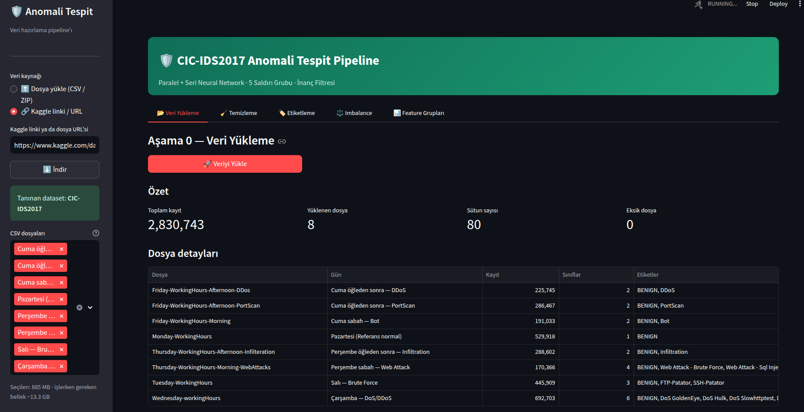
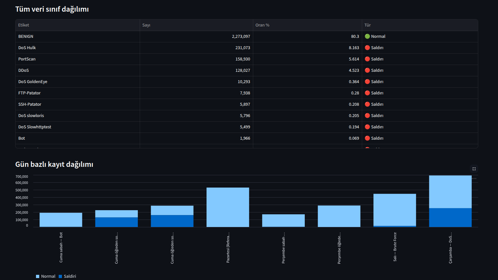
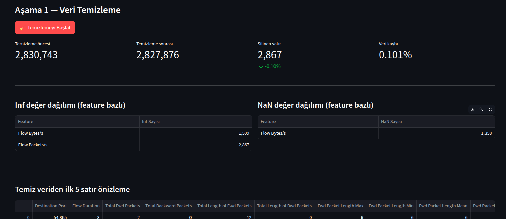
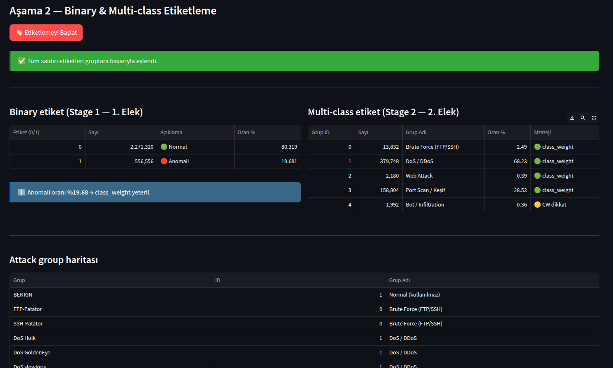
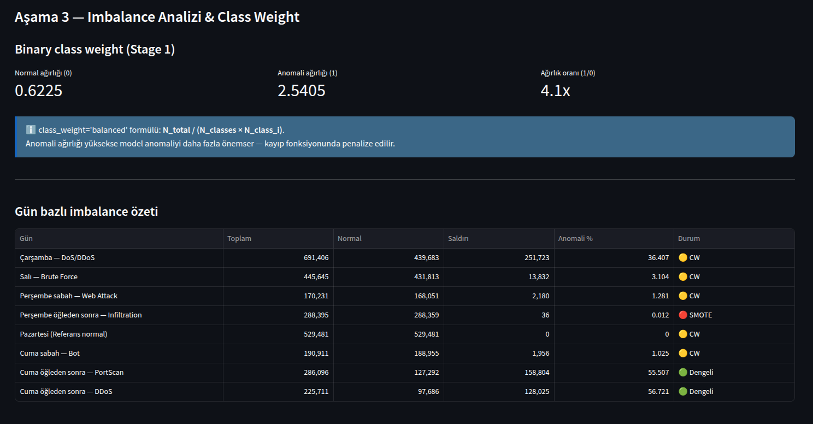
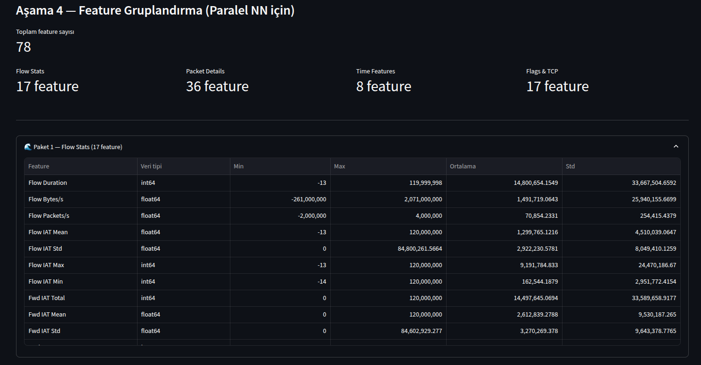
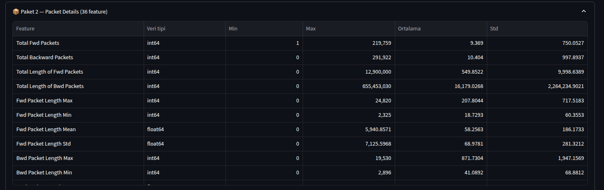
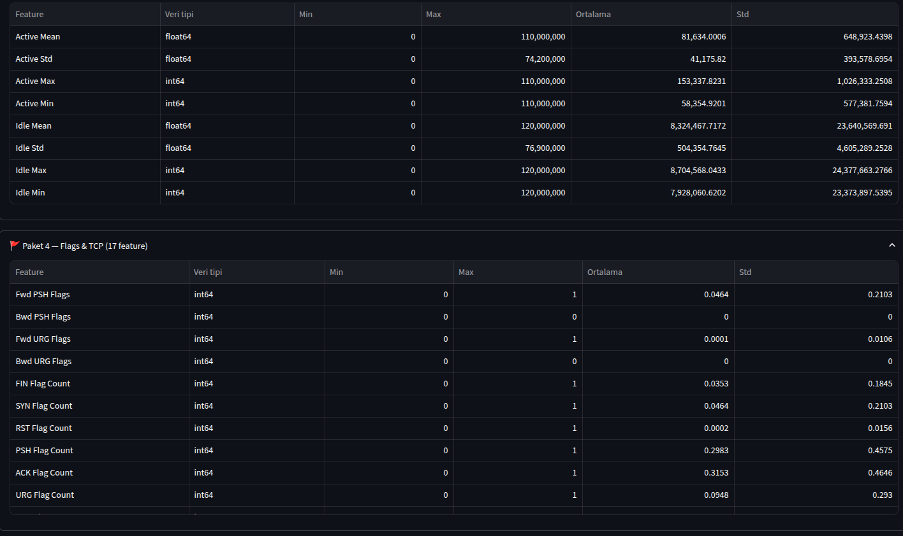

# Anomali Tespit Pipeline

Ağ trafiği datasetleri üzerinde iki aşamalı (binary → saldırı grubu) anomali tespiti için
veri hazırlama adımlarını gösteren Streamlit dashboard'u: yükleme, temizleme, etiketleme,
dengesizlik (imbalance) analizi ve paralel NN için feature gruplandırma.

Şu an desteklenen dataset: **CIC-IDS2017**. Yapı, karşılaştırma için başka datasetlerin
eklenebileceği şekilde kuruldu (bkz. [Yeni dataset eklemek](#yeni-dataset-eklemek)).

## Kurulum

```bash
python3 -m venv .venv
source .venv/bin/activate
pip install -r requirements.txt
```

## Veri

Repoda her dataset için yalnızca küçük bir **örnek veri** bulunur (`data/sample/<dataset>/`).
CIC-IDS2017 örneği ~14 bin satır, ~5 MB'tır; her etiketten orantılı satır içerir ve nadir
sınıflar (Heartbleed, Infiltration, SQL Injection) eksiksiz tutulmuştur.

**Tam veri** config'te tanımlı kaynaktan indirilir (CIC-IDS2017 için Kaggle, hesap gerekmez):

```bash
python scripts/download_data.py cicids2017
```

Script arşivi indirir, `data/raw/cicids2017/` altına açar ve her dosyayı boyut ve SHA-256 ile
doğrular. Dosyalar zaten varsa ve doğruysa tekrar indirmez.

Örnek veriyi tam veriden yeniden üretmek için: `python scripts/make_sample.py cicids2017`

## Çalıştırma

```bash
streamlit run anomali.py
```

Komutu proje klasöründen çalıştırın (`.streamlit/config.toml` ayarları buradan okunur).

Uygulama boş açılır; veri her oturumda kullanıcı tarafından yüklenir. Kenar çubuğunda iki
kaynak var, ikisinde de altta analize alınacak CSV'ler seçilir (aynı anda en fazla 10):

| Kaynak | Ne zaman |
|---|---|
| ⬆️ Dosya yükle (CSV / ZIP) | Bilgisayardaki dosyalar, dosya başına 1 GB'a kadar. ZIP diskte açılır. |
| 🔗 Kaggle linki / URL | Büyük veriler: dosyayı sunucu doğrudan indirir, tarayıcıdan geçmez, boyut sınırı yoktur. |

Yüklenen ya da indirilen dosyanın hangi datasete ait olduğu dosya adı, sütunlar ve etiketlerden
otomatik bulunur. Tanınmazsa etiket sütunu tahmin edilir ve eşlenmemiş etiketler listelenir.
Yüklenen/indirilen dosyalar `data/uploads/` altında tutulur (git'e eklenmez), aynı dosya
ikinci kez işlenmez.

## Klasör yapısı

```
anomali.py                 Streamlit dashboard
registry.py                datasets/*.toml dosyalarını okur, veri klasörlerini bulur
ingest.py                  İndirme, ZIP açma, yüklenen dosyaları diske alma
datasets/taxonomy.toml     Ortak saldırı grupları (tüm datasetler bunlara eşlenir)
datasets/cicids2017.toml   CIC-IDS2017: kaynak, dosyalar, hash'ler, etiket eşlemesi
scripts/download_data.py   Bir datasetin ham dosyalarını indirir ve doğrular
scripts/make_sample.py     Tam veriden tabakalı örnek üretir
data/sample/<dataset>/     Örnek veri (repoda)
data/raw/<dataset>/        Tam veri (indirilir, git'e eklenmez)
```

## Yeni dataset eklemek

1. `datasets/<ad>.toml` dosyasını `cicids2017.toml` örneğine göre yazın:
   - `[source]`: `type = "kaggle"` + `ref`, ya da `type = "url"` + `url` (zip ya da tek dosya)
   - `[files."<dosya adı>"]`: her dosya için `segment` ve `title` (`bytes`/`sha256` isteğe bağlı)
   - `[labels]`: her ham etiketi `taxonomy.toml`'daki bir gruba eşleyin
2. `python scripts/download_data.py <ad>` ile indirin. Hash vermediyseniz script değerleri
   yazdırır; config'e eklerseniz sonraki indirmeler doğrulanır.
3. `python scripts/make_sample.py <ad>` ile örnek veriyi üretin.
4. Dashboard'da Etiketleme sekmesi eşlenmemiş etiket kalırsa listeler.

Yeni dataset mevcut gruplara uymayan bir saldırı türü getirirse `taxonomy.toml`'a yeni grup
ekleyin. Mevcut grupların `id`'lerini değiştirmeyin, sıradaki boş `id`'yi kullanın.

## Analiz









## Notlar

- CIC-IDS2017'de "Web Attack – Brute Force" gibi etiketlerdeki tire, dağıtıma göre bozuk
  karakter olarak gelir (`\x96` ya da `�`). Config'teki `[label_normalize]` ile `-` yapılır.

## Kaynak

- CIC-IDS2017: Canadian Institute for Cybersecurity, University of New Brunswick —
  <https://www.unb.ca/cic/datasets/ids-2017.html>
- Kullanılan Kaggle kopyası (MachineLearningCVE CSV'leri):
  <https://www.kaggle.com/datasets/chethuhn/network-intrusion-dataset>
